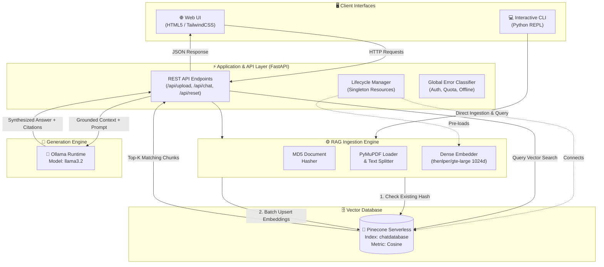
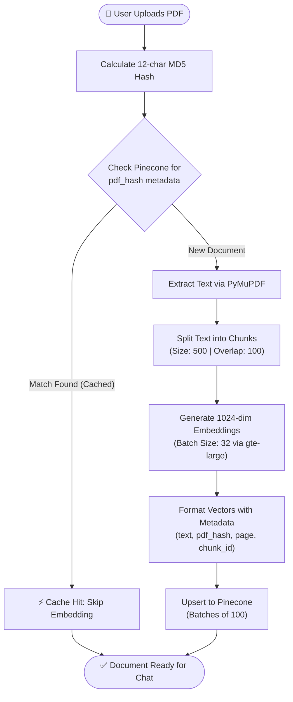
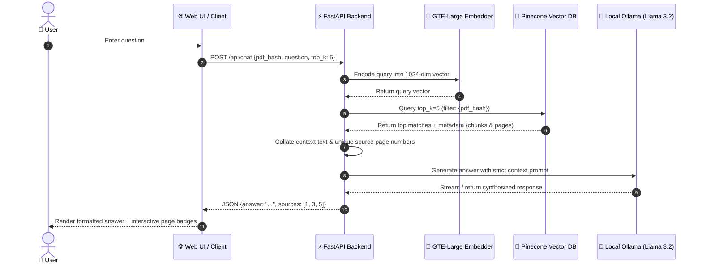

# 📄 DocuChat AI — Local PDF RAG with Pinecone & Ollama

<div align="center">

[](https://www.python.org/)
[](https://fastapi.tiangolo.com/)
[](https://www.pinecone.io/)
[](https://ollama.com/)
[-yellow.svg?logo=huggingface&logoColor=white)](https://huggingface.co/thenlper/gte-large)
[](LICENSE)

**A high-performance, privacy-focused Retrieval-Augmented Generation (RAG) system for chatting with PDF documents.**  
Extracts document text, creates 1024-dimensional semantic embeddings locally, indexes them in Pinecone with MD5-based deduplication, and generates context-grounded answers with source citations using local LLMs.

[Features](#-key-features) • [Architecture](#-system-architecture) • [Flowcharts](#-data-and-query-flowcharts) • [Tech Stack](#-tech-stack) • [Quickstart](#-quickstart-guide) • [API Reference](#-api-reference) • [Configuration](#-configuration)

---

</div>

## 🌟 Key Features

- **⚡ Zero-Redundancy Smart Deduplication**: Computes an MD5 checksum for every uploaded PDF and queries Pinecone metadata before processing. Existing documents are ready instantaneously without consuming embedding compute or vector storage quotas.
- **🔒 100% Private Local Inference**: Answers are synthesized locally using **Llama 3.2** via Ollama—ensuring your sensitive document contents are never transmitted to third-party proprietary LLM APIs.
- **🎯 Accurate Grounding & Page Citations**: Responses are strictly anchored in retrieved context chunks. Each answer includes verifiable source page numbers directly from the source PDF.
- **🚀 High-Throughput Batch Processing**: Text extraction via `PyMuPDF`, recursive semantic chunking (`chunk_size=500`, `chunk_overlap=100`), batch-encoded 1024-dimensional vectors with `thenlper/gte-large`, and batch upserts to Pinecone (100 vectors/batch).
- **🎨 Modern Web UI & Interactive CLI**: Includes a responsive web interface with real-time ingestion status, citation badges, and chat management, alongside a CLI for terminal-based workflows.
- **🛡️ Resilient Error Architecture**: Built-in typed exception handling classifies auth failures, quota limits, and engine outages, delivering structured diagnostics and preventing server crashes.

---

## 🏗️ System Architecture



---

## 🔄 Data and Query Flowcharts

### 1. Ingestion & Smart Deduplication Pipeline



### 2. Retrieval-Augmented Generation (Q&A) Flow



---

## 🛠️ Tech Stack

| Layer | Component | Description |
| :--- | :--- | :--- |
| **Document Processing** | `PyMuPDF` (`fitz`) | High-speed PDF parsing and page-aware text extraction |
| **Text Chunking** | `langchain-text-splitters` | `RecursiveCharacterTextSplitter` preserving semantic boundaries |
| **Embeddings** | `sentence-transformers` | `thenlper/gte-large` producing **1024-dimensional** dense vectors |
| **Vector Database** | `Pinecone` | Serverless cloud vector database with metadata filtering |
| **LLM Inference** | `Ollama` | Local, hardware-accelerated runtime executing `llama3.2` |
| **Backend API** | `FastAPI` + `Uvicorn` | Asynchronous REST API with threadpooled compute dispatch |
| **Frontend UI** | Modern HTML5 + `TailwindCSS` | Responsive glassmorphic interface with real-time feedback |

---

## 📂 Project Structure

```text
Retrieval-Augmented-Generation/
├── app.py                  # Standalone CLI script for PDF indexing & querying
├── main.py                 # FastAPI production backend & API endpoints
├── rag_engine.py           # Core RAG engine, exception classes, & CLI
├── static/
│   └── index.html          # Modern, responsive single-page chat UI
├── how things work/        # Architecture notes and vector search guides
│   ├── oldRAG_knowledge.md
│   └── vector_search_in_pinecone.md
├── .env.example            # Environment variable template
├── requirements.txt        # Python dependency manifest
└── README.md               # Project documentation
```

---

## 📋 Prerequisites

Ensure your system meets the following prerequisites before running the project:

1. **Python 3.9+** installed.
2. **Pinecone Account & Index**:
   - Register at [pinecone.io](https://www.pinecone.io/) (free tier available).
   - Create an index with the following specifications:
     - **Index Name:** `chatdatabase` (or name defined in `.env`)
     - **Dimensions:** `1024` (matches `thenlper/gte-large`)
     - **Metric:** `cosine`
3. **Ollama Installed & Running**:
   - Download and install [Ollama](https://ollama.com/).
   - Pull the default language model:
     ```bash
     ollama pull llama3.2
     ```
   - Ensure the daemon is running in the background (`ollama serve`).

---

## 🚀 Quickstart Guide

### 1. Clone & Navigate to Repository

```bash
git clone https://github.com/dhananjaykumar137c-netizen/Retrieval-Augmented-Generation.git
cd Retrieval-Augmented-Generation
```

### 2. Create and Activate a Virtual Environment

```bash
# Windows (PowerShell)
python -m venv venv
venv\Scripts\Activate.ps1

# Windows (Command Prompt)
python -m venv venv
venv\Scripts\activate.bat

# macOS / Linux
python3 -m venv venv
source venv/bin/activate
```

### 3. Install Dependencies

```bash
pip install -r requirements.txt
```

### 4. Configure Environment Variables

Create a `.env` file in the project root based on [.env.example](file:///.env.example):

```env
# Pinecone Configuration
PINECONE_API_KEY=your_actual_pinecone_api_key_here
PINECONE_INDEX_NAME=chatdatabase

# Local LLM Configuration (Ollama)
LLM_MODEL=llama3.2
```

---

## 🖥️ Running the Application

### Option A: Modern Web Application (Recommended)

Start the FastAPI application with Uvicorn:

```bash
uvicorn main:app --reload --host 127.0.0.1 --port 8000
```

Open your browser and navigate to:
```
http://localhost:8000
```

1. **Upload:** Drag and drop or browse to select any PDF.
2. **Process:** The system checks for existing hashes; if new, it parses, embeds, and uploads vectors automatically.
3. **Chat:** Ask any question regarding the document. Receive answers grounded in the text alongside source page citations!

---

### Option B: Interactive Terminal CLI

Run the modular CLI directly from your terminal:

```bash
python rag_engine.py
```
*(By default, this processes `os.pdf` or a path configured via `PDF_FILE` environment variable).*

Alternatively, run the lightweight standalone script:
```bash
python app.py
```

---

## 📡 API Reference

### `POST /api/upload`
Uploads and processes a PDF file. Returns instantly if the document hash already exists in Pinecone.

- **Content-Type:** `multipart/form-data`
- **Payload:** `file` (Binary PDF data)

**Response (`200 OK`):**
```json
{
  "status": "ready",
  "pdf_hash": "a1b2c3d4e5f6",
  "filename": "operating_systems.pdf",
  "cached": false
}
```

---

### `POST /api/chat`
Performs semantic vector retrieval against the indexed PDF and generates a grounded response.

- **Content-Type:** `application/json`
- **Request Body:**
```json
{
  "pdf_hash": "a1b2c3d4e5f6",
  "question": "What is the difference between paging and segmentation?",
  "top_k": 5
}
```

**Response (`200 OK`):**
```json
{
  "answer": "Paging divides memory into fixed-sized blocks called pages, whereas segmentation divides memory into variable-sized logical units such as functions or data modules...",
  "sources": [42, 45, 48]
}
```

---

### `POST /api/reset`
Acknowledges a session or chat history reset.

**Response (`200 OK`):**
```json
{
  "status": "ok",
  "message": "Session reset acknowledged."
}
```

---

## ⚙️ Configuration

The following parameters can be customized via `.env` or adjusted within [rag_engine.py](file:///rag_engine.py):

| Variable / Constant | Default Value | Description |
| :--- | :--- | :--- |
| `PINECONE_API_KEY` | *(Required)* | Your secret API key from the Pinecone dashboard |
| `PINECONE_INDEX_NAME`| `chatdatabase` | Target Pinecone vector index |
| `LLM_MODEL` | `llama3.2` | Ollama model tag for response generation |
| `EMBED_MODEL` | `thenlper/gte-large` | Hugging Face embedding model (1024 dimensions) |
| `CHUNK_SIZE` | `500` | Target character length for document text chunks |
| `CHUNK_OVERLAP` | `100` | Overlap between adjacent chunks to maintain context continuity |
| `UPSERT_BATCH_SIZE` | `100` | Number of vector records per Pinecone upsert request |
| `ENCODE_BATCH_SIZE` | `32` | Batch size for `SentenceTransformer` inference |

---

## 🛡️ Error Handling & Reliability

DocuChat incorporates dedicated exception handling for robust, graceful failure recovery:

- **`BillingOrQuotaError` (HTTP 402/429):** Caught when Pinecone vector quotas or billing limits are exceeded. Returns user-friendly alerts instead of generic crashes.
- **`AuthFailedError` (HTTP 401/403):** Triggered when the Pinecone API key is invalid or expired.
- **`EngineOfflineError` (HTTP 503):** Triggered if Ollama is not running (`ollama serve`) or the vector database connection drops.

---

## 🤝 Contributing

Contributions, issues, and feature requests are welcome!
1. Fork the Project.
2. Create your Feature Branch (`git checkout -b feature/AmazingFeature`).
3. Commit your Changes (`git commit -m 'Add some AmazingFeature'`).
4. Push to the Branch (`git push origin feature/AmazingFeature`).
5. Open a Pull Request.

---

## 📄 License

Distributed under the MIT License. See `LICENSE` for more information.