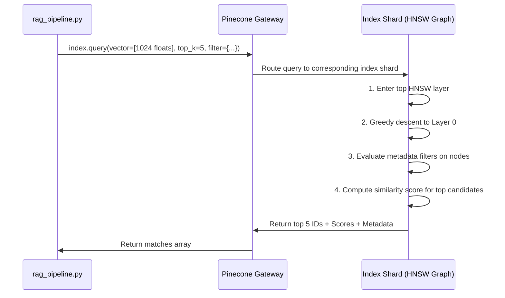

# Vector Search in Pinecone: Internals, Algorithms, and Customization

This document explains how vector search operates inside Pinecone, how indices work under the hood, the algorithms utilized, proof of Approximate Nearest Neighbor (ANN) search, and alternatives if you want full algorithmic control.

---

## 1. How Vector Search is Performed in Pinecone Using an Index

When you call `index.query(vector=question_embedding, top_k=5)` in Pinecone, it executes an **Approximate Nearest Neighbor (ANN)** search.

### A. The Scaling Problem (Why an "Index" is Needed)
Comparing a query vector against every stored vector (**Exact $k$-Nearest Neighbors / Brute-force**) requires calculating vector similarity against all $N$ entries:
$$\text{Time Complexity: } \mathcal{O}(N \times D)$$
*(where $N$ = number of vectors, $D$ = vector dimensions, e.g., 1024).*

At scale (thousands or millions of vectors), brute-force linear search is too slow for real-time applications. An **Index** is a specialized, pre-built spatial data structure that enables Pinecone to locate the closest vectors in logarithmic time $\mathcal{O}(\log N)$ without evaluating every vector.

---

### B. The Core Algorithm: HNSW (Hierarchical Navigable Small World)

Pinecone primarily relies on graph-based indexing algorithms—specifically **HNSW** (or proprietary variants of it)—alongside quantization techniques:

```
[Layer 2 - Express Highway]    (Node A) --------------> (Node Z)
                                  |                        |
[Layer 1 - State Route]        (Node A) ---> (Node M) -> (Node Z)
                                  |             |          |
[Layer 0 - All Vectors]        (A)-(B)-(C)-(D)-(M)-(O)-(P)-(Z)
```

1. **Multi-layer Graph Structure**:
   * **Top layers (sparse)**: Contain few vectors with long-range links (similar to express highways).
   * **Bottom layer (dense)**: Contains all vectors connected to their nearest semantic neighbors (similar to local neighborhood streets).
2. **Graph Traversal (Beam Search)**:
   * The query vector enters at the top layer.
   * It hops across long-distance nodes toward the direction of highest similarity.
   * When no closer neighbor can be found at the current layer, it drops down to the next denser layer.
   * At **Layer 0**, it explores the immediate local neighborhood and gathers the `top_k` closest candidates.

---

### C. Similarity Metrics

When creating an index in Pinecone, you select a distance/similarity metric:

| Metric | Formula | How it Works |
| :--- | :--- | :--- |
| **Cosine** | $\frac{\vec{u} \cdot \vec{v}}{\|\vec{u}\| \|\vec{v}\|}$ | Measures the **angle** between vectors (ignoring magnitude). Score ranges from -1 to 1. |
| **Dot Product** | $\vec{u} \cdot \vec{v} = \sum u_i v_i$ | If vectors are $L_2$-normalized (as done by `SentenceTransformer`), Dot Product is identical to Cosine Similarity, but computes faster by skipping division. |
| **Euclidean (L2)** | $\sqrt{\sum (u_i - v_i)^2}$ | Measures straight-line geometric distance. Smaller distance = higher similarity. |

---

### D. Single-Stage Metadata Filtering

When querying with a metadata filter:
```python
results = index.query(
    vector=dummy_vector,
    filter={"pdf_hash": pdf_hash},
    top_k=1
)
```

Pinecone implements **Single-Stage Filtered Vector Search**:
* Instead of *post-filtering* (searching top 100 vectors then discarding non-matches) or *pre-filtering* (brute-forcing all metadata matches), Pinecone evaluates metadata filters **during the HNSW graph traversal**.
* Candidate nodes failing the metadata condition are bypassed during graph navigation, avoiding performance degradation while ensuring exact filter compliance.

---

### E. End-to-End Query Lifecycle



---

## 2. Code Inspection & Proof of ANN in Pinecone

### A. Can You Spot the Search Algorithm in `pinecone.py`?

In `pinecone/pinecone.py` (around line 325):
```python
def Index(self, name: str = "", host: str = "", **kwargs) -> "Index":
    ...
    return _Index(host=index_host, ...)
```

**The vector search algorithm is NOT inside the local Python SDK.**

* **Client/SDK Role**: The installed `pinecone` Python package is an API client wrapper.
* **Network Call**: When calling `index.query(...)`, the client serializes your vector into JSON/Protobuf and transmits an HTTPS/gRPC request to:
  `https://<your-index-name>.svc.<region>.pinecone.io/query`
* **Server-side Execution**: The actual search engine is closed-source proprietary software (written in C++ and Rust) executing on Pinecone's cloud infrastructure.

---

### B. Proof That Pinecone Uses ANN

The proof is documented in Pinecone's technical whitepapers, patents, and official architecture guides:

1. **Official Definition**: Pinecone states in its documentation:
   > *"Pinecone provides vector search using **Approximate Nearest Neighbor (ANN)** search algorithms to deliver sub-50ms query latencies over millions or billions of items."*
2. **Architecture Documentation & Engineering Blogs**:
   * Pinecone published deep-dives on their graph implementations: [Pinecone: Hierarchical Navigable Small World (HNSW)](https://www.pinecone.io/learn/series/faiss/hnsw/).
   * Pinecone's Pod architecture explicitly splits algorithms by workload:
     * **`p2` Pods (Graph-based)**: Optimized for sub-10ms queries using in-memory HNSW graph traversal.
     * **`s1` Pods (Storage-optimized)**: Uses **IVF-PQ (Inverted File with Product Quantization)** to balance memory and cost for large-scale datasets.
     * **Serverless Indexes**: Separates storage from compute, using geometric clustering and selective sub-cluster retrieval.

---

### C. Why Only ANN? Could It Use Other Algorithms?

In low dimensions (e.g., 2D/3D spaces), exact spatial partition trees like **$k$-d trees** or **R-trees** work well.

In high-dimensional embeddings (e.g., $D = 1024$ in `gte-large`):
* **The Curse of Dimensionality**: High-dimensional vectors tend to be equidistant. Spatial partition trees break down mathematically and degrade into linear brute-force scanning $\mathcal{O}(N \times D)$.
* **Compute Burden of Exact $k$-NN**: Searching 10 million 1024-dimension vectors requires roughly 10 billion floating-point operations per query, resulting in seconds of latency instead of milliseconds.

Therefore, **Approximate Nearest Neighbor (ANN)** is mathematically the only practical approach for sub-50ms search at scale.

---

## 3. How to Use Different Algorithms (FAISS & Other Vector DBs)

Because Pinecone is a managed, proprietary cloud platform, you cannot inject arbitrary low-level search algorithms into their servers. You can only configure high-level settings (metrics: `cosine`, `dotproduct`, `euclidean`, and index tiers: Serverless, `p2`, `s1`).

If you need full control over the exact search algorithm, use an open-source vector library or self-hosted database:

### Option 1: FAISS (Facebook AI Similarity Search)
FAISS gives you complete algorithmic control:

```python
import faiss
import numpy as np

d = 1024  # Vector dimension

# 1. Exact Brute-Force (k-NN) - No approximation, 100% precision, slower:
index = faiss.IndexFlatIP(d)  # Inner Product (Cosine on normalized vectors)

# 2. Inverted File (IVF) - Partitions space into Voronoi cells:
quantizer = faiss.IndexFlatL2(d)
index = faiss.IndexIVFFlat(quantizer, d, nlist=100)  # 100 clusters

# 3. Graph-based (HNSW) - Navigable Small World graph:
index = faiss.IndexHNSWFlat(d, 32)  # 32 bi-directional links per node

# 4. Product Quantization (IVF-PQ) - Compresses vectors for minimal RAM footprint:
index = faiss.IndexIVFPQ(quantizer, d, nlist=100, m=8, nbits=8)
```

### Option 2: Qdrant / ChromaDB / Weaviate
* **Exact Brute-Force**: Enable `exact=True` for 100% recall without approximations.
* **HNSW Tuning**: Directly adjust `m` (links per node), `ef_construct` (build accuracy), and `ef_search` (query-time accuracy vs speed).
* **Disk-backed ANN**: Switch to **DiskANN** / Vamana to query large indices directly from SSD rather than RAM.
